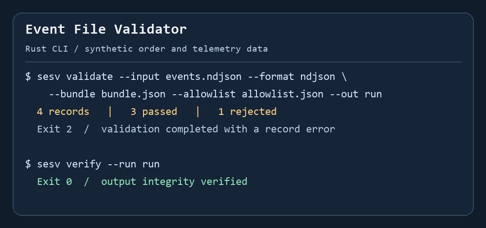

# Event Data Quality Gate

**Scenario.** A data engineer receives four JSON events for import. One order total is a cent higher than the sum of its line items. The gate checks each event against the chosen rules and writes the three passing records to a separate file.

**Value.** The engineer can verify the file of passing records and hand it off for import. The source team gets the exact rule that failed and can correct the one bad order.



The image summarizes an actual run with the included sample files.

## Quick start

Use Ubuntu 24.04 x86-64, Rust and Cargo 1.100, and a native C linker. Build from the repository root. Cargo fetches the locked dependencies. The CLI runs offline.

```bash
cargo fetch --locked
CARGO_PROFILE_RELEASE_CODEGEN_UNITS=1 cargo build --release --offline --locked --all-targets
workdir=$(mktemp -d)
target/release/examples/demo_policy "$workdir/demo"
```

Follow [Linux setup](docs/linux-setup.md) to install the binary and load the AppArmor profile on the reference platform. Run the validator as an ordinary user.

```bash
/opt/sesv/bin/sesv validate --input "$workdir/demo/events.ndjson" --format ndjson \
  --bundle "$workdir/demo/bundle.json" --allowlist "$workdir/demo/allowlist.json" \
  --out "$workdir/run"
/opt/sesv/bin/sesv verify --run "$workdir/run"
```

The example uses generated telemetry and order data. Validation reports three valid records and one invalid order and exits with code 2. Verification checks the four output files and exits with code 0. Read `results.ndjson` for the failing rule and `valid.ndjson` for passing records.

## Inputs and outputs

Use `json` for one event, `ndjson` for one event per line, or `cloudevents-json` for the supported CloudEvents JSON profile. Each validation needs a fresh output directory on a supported local filesystem. The result directory contains `results.ndjson`, `valid.ndjson`, `manifest.json`, and `COMPLETE.json`.

The CLI supervises a Linux worker. It checks the staged files before it publishes the completion marker. The verifier checks artifact integrity using the output directory alone. Use the caller's access controls for both inputs and exports. Policy authority and import decisions stay with the operator.

## Tests

```bash
cargo fmt --all --check
cargo test --offline --locked
cargo clippy --offline --locked --all-targets -- -D warnings
```

See [validation results](docs/validation.md) for the build identity and the checks run on the Ubuntu reference host. Dependency license texts are in `licenses/`.
